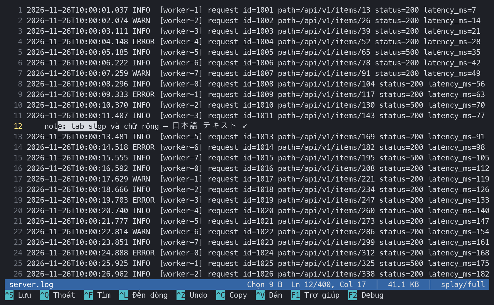
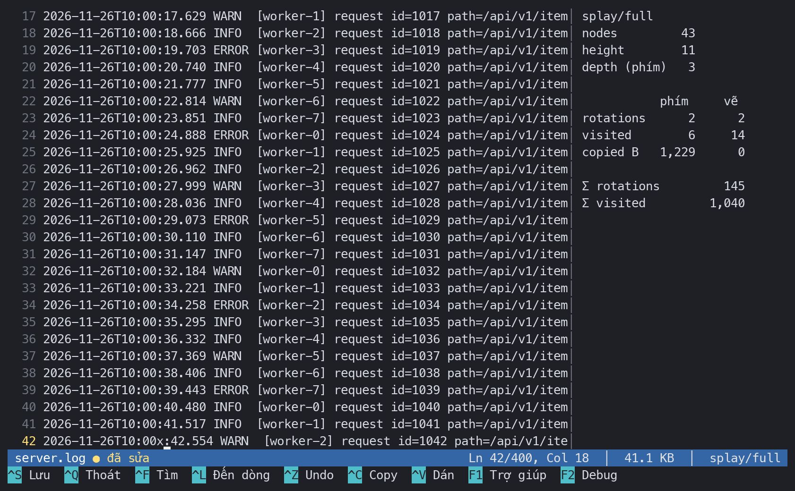
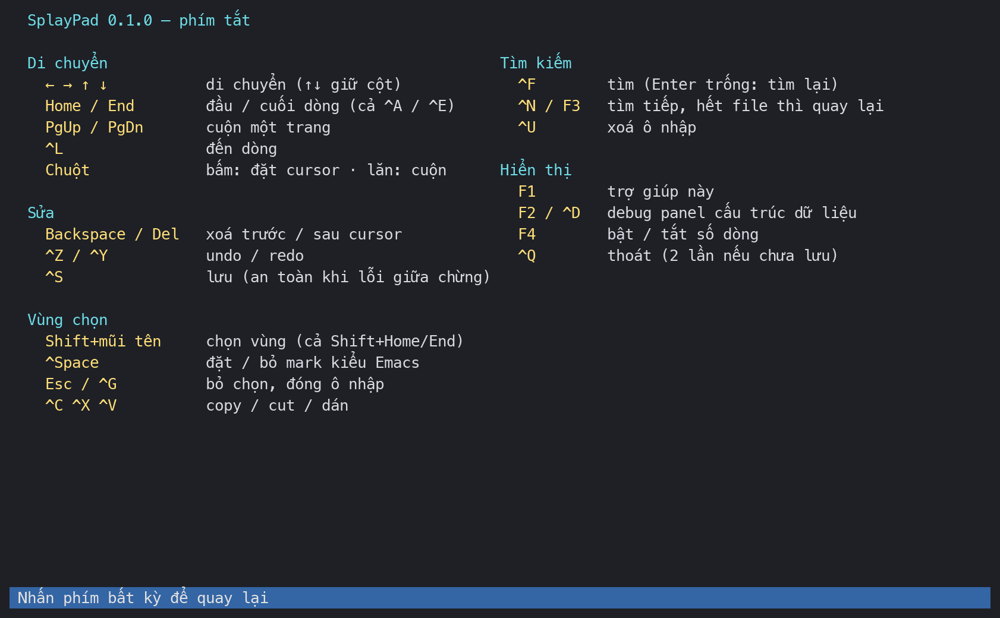

# SplayPad

Trình soạn thảo văn bản (terminal) cho file rất lớn, dựa trên rope cài bằng implicit splay tree.
Bài tập lớn môn Cấu trúc dữ liệu và Giải thuật nâng cao.



Mở file 100MB trong khoảng 0,15 giây; gõ, xoá, dán, tìm và nhảy dòng đều trong vài micro giây nhờ rope cân bằng
tự điều chỉnh. Kết quả đo chi tiết ở `report/`.

## Yêu cầu

- Python ≥ 3.11 (phát triển trên 3.12), macOS hoặc Linux (`curses` không có sẵn trên Windows)
- Terminal UTF-8 (xterm, iTerm2, GNOME Terminal, tmux …)

## Cài đặt

```bash
make install          # tạo .venv, cài package + công cụ dev/bench, ghi requirements-lock.txt
make test             # unit + giao diện (pty) + differential test
make lint             # ruff + mypy
```

## Chạy

```bash
make run FILE=path/to/file.txt
# hoặc
.venv/bin/splaypad FILE [--read-only] [--tab-width 4] [--no-line-numbers] [--no-mouse]
.venv/bin/splaypad --help
```

File chưa tồn tại thì mở buffer rỗng, tạo file khi lưu. File không có quyền ghi tự mở ở chế độ chỉ đọc.

| Phím | Thao tác |
|---|---|
| ← → ↑ ↓ | di chuyển (↑↓ giữ cột hiển thị khi đi qua dòng ngắn) |
| Home / End, Ctrl-A / Ctrl-E | đầu / cuối dòng |
| PgUp / PgDn | cuộn một trang |
| Ctrl-L | đến dòng |
| Chuột | bấm để đặt cursor, lăn để cuộn (tắt bằng `--no-mouse` để chọn chữ bằng chuột của terminal) |
| Backspace / Delete | xoá trước / sau cursor |
| Ctrl-Z / Ctrl-Y | undo / redo (gõ liền nhau gộp theo từ; một lần dán là một bước) |
| Ctrl-S | lưu |
| Shift+mũi tên, Shift+Home/End | chọn vùng (mũi tên thường thì bỏ chọn) |
| Ctrl-Space | đặt / bỏ mark – chọn kiểu Emacs (dùng khi terminal không gửi Shift+mũi tên) |
| Esc / Ctrl-G | bỏ chọn, đóng ô nhập |
| Ctrl-C / Ctrl-X / Ctrl-V | copy / cut / paste – dùng clipboard hệ thống (pbcopy, wl-copy, xclip, xsel) nếu có |
| Ctrl-F, Ctrl-N / F3 | tìm (Enter để trống = tìm lại), tìm tiếp; Ctrl-U xoá ô nhập |
| F1 | bảng phím tắt |
| F2 / Ctrl-D | debug panel: nodes, height, phép quay / node đã thăm / byte đã copy của phím vừa bấm và của lần vẽ |
| F4 | bật / tắt số dòng |
| Ctrl-Q | thoát (bấm hai lần nếu chưa lưu) |

| Debug panel (F2) | Trợ giúp (F1) |
|---|---|
|  |  |

### An toàn dữ liệu

- **Lưu nguyên tử:** ghi ra file tạm cùng thư mục rồi `os.replace`, giữ nguyên quyền file; lỗi giữa chừng không làm
  hỏng file cũ.
- **File bị sửa bên ngoài:** nếu chương trình khác đã sửa file từ lúc mở, Ctrl-S bị từ chối kèm cảnh báo; bấm Ctrl-S
  lần nữa mới ghi đè.
- **Khôi phục:** app lỗi, bị `kill`, hoặc terminal bị đóng khi còn thay đổi chưa lưu → nội dung được ghi vào
  `FILE.splaypad-recover` (không ghi được cạnh file thì vào `~/.local/state/splaypad/recover/`), đường dẫn in ra sau
  khi thoát. Lần mở sau sẽ cảnh báo nếu còn file khôi phục.

### Log

Log ghi ra `~/.local/state/splaypad/splaypad.log` (theo `$XDG_STATE_HOME`), xoay vòng 1MB × 3 file: mở/lưu file,
thời gian, phím hoặc khung hình chậm (≥ 100ms), lỗi kèm traceback. **Không** ghi nội dung văn bản hay chuỗi người
dùng gõ/tìm.

| Tuỳ chọn | Biến môi trường | Mặc định |
|---|---|---|
| `--log-level DEBUG\|INFO\|WARNING\|ERROR\|OFF` | `SPLAYPAD_LOG_LEVEL` | `INFO` |
| `--log-file PATH` | `SPLAYPAD_LOG_FILE` | `$XDG_STATE_HOME/splaypad/splaypad.log` |
| – | `SPLAYPAD_CLIPBOARD=internal` | `auto` (dùng clipboard hệ thống nếu có công cụ) |
| – | `NO_COLOR=1` | có màu (tự tắt khi terminal không hỗ trợ) |

Mã thoát: `0` bình thường, `1` lỗi không lường trước, `2` sai tham số / không mở được file, `128+n` khi bị tín hiệu `n`.

### Giới hạn đã biết

- Clipboard hệ thống cần một trong các công cụ ở trên; qua SSH thì chỉ có clipboard nội bộ.
- Chưa có tìm ngược / thay thế, chưa có tô màu cú pháp.

## Ghi trace thật

```bash
make record NAME=report BASE=report/report.md
```

Mở bản sao của `BASE` trong SplayPad; mọi thao tác lên buffer (sửa, đọc khi render, tra dòng) được ghi vào
`bench/traces/real/NAME.trace`, file nền gốc lưu ở `NAME.base` để benchmark phát lại đúng nội dung ban đầu.
Định dạng trace: `src/splaypad/editor/trace.py`.

## Tái lập kết quả

```bash
make bench && make plots
```

`make bench` sinh file nền và trace tổng hợp (có seed) nếu chưa có, chạy ma trận RQ1–RQ4 (mỗi lượt một process
riêng, tối đa 30s phát lại mỗi lượt) và ghi `bench/results/bench-<thời điểm>-<commit>.csv` cùng file `.env.json`
(CPU, RAM, OS, Python, `pip freeze`). Mất khoảng 1–1,5 giờ trên Apple M4; nên cắm sạc và đóng ứng dụng nặng.
`make plots` đọc CSV mới nhất, sinh `report/figures/*.png` và bảng số liệu `report/tables/*.md`.

Thử nhanh harness (file 1MB, 1 lượt, ghi vào `bench/logs/quick/` để không lẫn kết quả thật): `.venv/bin/python -O bench/runner.py --quick`. Xem ma trận: `--dry-run`.

## Báo cáo

Viết bằng Markdown ở `report/report.md`, chuyển bằng [Pandoc](https://pandoc.org):

```bash
make report         # → report/report.pdf  (cần thêm: brew install typst)
make report-docx    # → report/report.docx (chỉ cần pandoc)
```

## Cấu trúc thư mục

```
src/splaypad/core/     TextBuffer và các cài đặt (SplayRope, TreapRope, GapBuffer, PieceTable, NaiveBuffer)
src/splaypad/editor/   Command, undo/redo, cursor, độ rộng hiển thị, find, clipboard, trace
src/splaypad/ui/       giao diện curses: vòng lặp, phím/chuột, theme, debug panel
src/splaypad/log.py    cấu hình logging
tests/                 unit, invariant, differential, end-to-end trong pty (ptyterm.py: màn hình qua pyte)
bench/                 sinh trace, runner, plot, kết quả CSV
scripts/screenshots.py chụp ảnh màn hình cho README (docs/img/)
report/                báo cáo Markdown (report.md) + references.bib + figures/ + diagrams/
docs/                  decisions.md (ADR), img/
```
