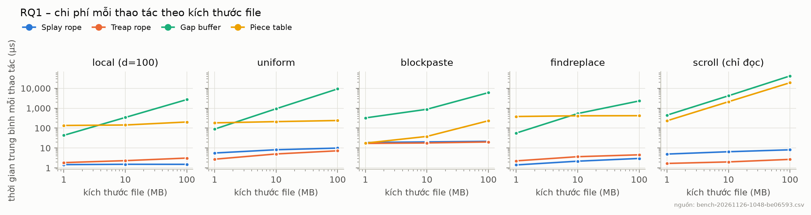
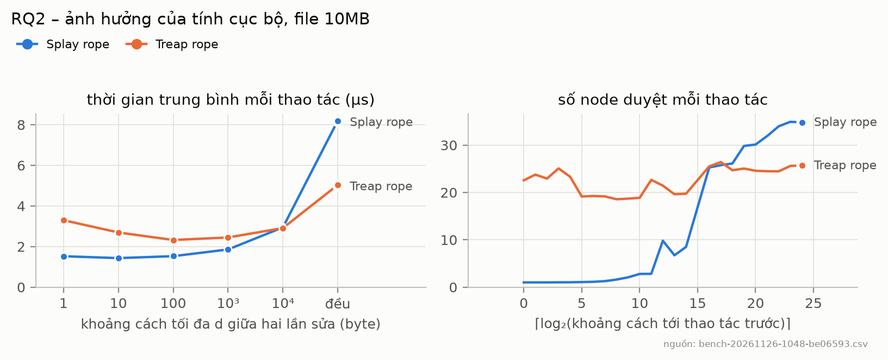
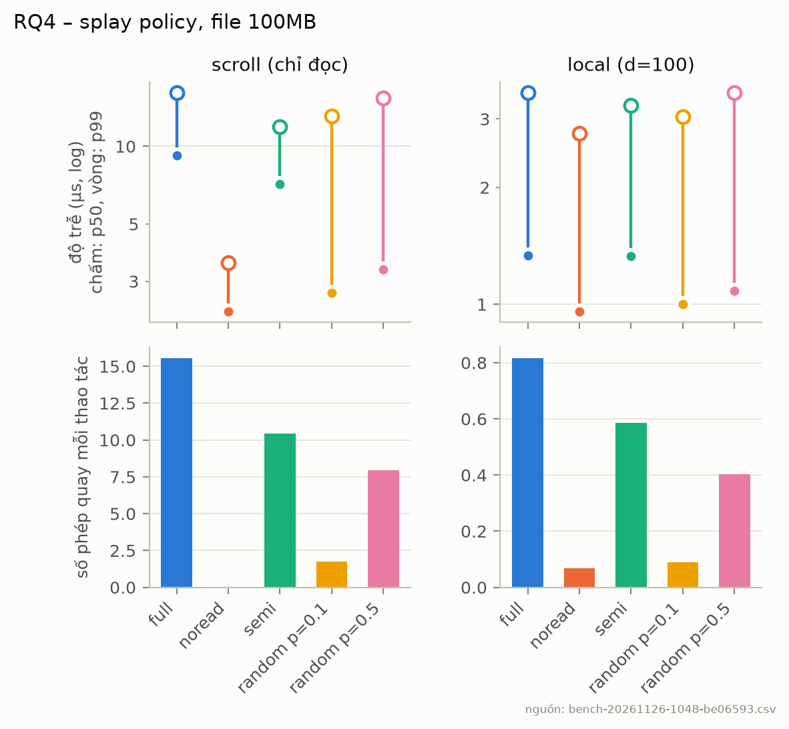

<!--
Cách viết:
- Trích dẫn: [@sleator1985], nhiều nguồn: [@cole2000a; @cole2000b]. Khoá nằm trong references.bib.
- Công thức: $O(\log n)$ hoặc khối $$...$$.
- Hình:  — chỉ dùng hình do `make plots` sinh ra.
- Xuất: make report (PDF, cần typst) hoặc make report-docx (Word).
- Các khối chú thích như khối này không xuất hiện trong PDF/Word.
-->

# Giới thiệu

Các trình soạn thảo phổ thông thường chậm hoặc treo khi mở những file lớn hàng trăm megabyte như file log, bản dump cơ sở dữ liệu hay file CSV. Nguyên nhân nằm ở cấu trúc lưu văn bản: khi văn bản được lưu trong một mảng liên tục hoặc một gap buffer, mỗi thao tác chèn hay xoá ở vị trí xa con trỏ hiện tại đều phải dời một lượng dữ liệu tỉ lệ với kích thước file, tức tốn $O(n)$. Với file 100MB, một lần dán hay xoá ở giữa file có thể phải dời hàng chục megabyte.

*Rope* [@boehm1995] giải quyết vấn đề này bằng cách biểu diễn chuỗi dưới dạng cây nhị phân, trong đó mỗi lá giữ một đoạn văn bản ngắn và mỗi nút trong lưu tổng độ dài của cây con. Nhờ đó các thao tác chèn, xoá, cắt và dán đều đưa về $O(\log n)$ nếu cây được giữ cân bằng. Câu hỏi còn lại là chọn cơ chế cân bằng nào.

Thao tác soạn thảo có một tính chất đặc biệt: **tính cục bộ cao**. Người dùng gõ liên tục quanh con trỏ, sửa đi sửa lại một vùng nhỏ, và phần lớn thời gian chỉ nhìn một màn hình văn bản. *Splay tree* [@sleator1985] là cây tìm kiếm nhị phân tự điều chỉnh: mỗi nút sau khi được truy cập sẽ được đưa lên gốc bằng một dãy phép quay. Ngoài chi phí khấu hao $O(\log n)$ cho mỗi thao tác, splay tree còn có những đảm bảo mạnh hơn đúng với kiểu truy cập này. *Working-set theorem* cho biết truy cập một phần tử vừa được dùng gần đây có chi phí nhỏ; *dynamic finger theorem* [@cole2000a; @cole2000b] cho biết chi phí truy cập chỉ tăng theo logarit của khoảng cách tới lần truy cập trước. Về lý thuyết, một rope cài bằng splay tree vì thế là ứng viên tự nhiên cho trình soạn thảo.

Tuy nhiên, những đảm bảo này là tiệm cận và khấu hao. Trong thực tế, splay tree phải trả giá cho các phép quay ở *mọi* lần truy cập, kể cả khi chỉ đọc để hiển thị màn hình, trong khi các cấu trúc như treap, piece table [@vscode2018] hay gap buffer không có chi phí này. Lợi thế của splay tree trên thao tác soạn thảo thật vì vậy cần được kiểm chứng bằng thực nghiệm, không thể chỉ suy ra từ lý thuyết.

## Câu hỏi nghiên cứu

Báo cáo này trả lời bốn câu hỏi:

- **RQ1.** Trên thao tác soạn thảo thực tế, rope dùng splay tree hơn kém thế nào so với rope dùng treap, piece table và gap buffer về thời gian, bộ nhớ và độ trễ mỗi thao tác (p50/p95/p99)?
- **RQ2.** Mức độ cục bộ của thao tác ảnh hưởng thế nào đến lợi thế của splay tree? Chi phí truy cập có tăng theo logarit khoảng cách như dynamic finger theorem dự đoán không?
- **RQ3.** Kích thước đoạn văn bản mỗi nút (16, 64, 256, 1024 byte) ảnh hưởng thế nào đến hiệu năng và bộ nhớ?
- **RQ4.** Thao tác đọc để hiển thị cũng gây splay. Biến thể nào cho độ trễ tốt nhất: splay đầy đủ, không splay khi đọc, semi-splay, hay splay ngẫu nhiên [@albers2002]?

## Đóng góp

1. **SplayPad**, một trình soạn thảo chạy trên terminal, mở và sửa được file từ 100MB trở lên, dựa trên rope cài bằng implicit splay tree có chia đoạn (chunking) và lưu thêm số dòng ở mỗi nút để nhảy tới dòng bất kỳ trong $O(\log n)$.
2. **Một thư viện rope tách riêng** cùng các cấu trúc đối chứng, tất cả cài bằng Python thuần trên cùng một giao diện và cùng qua một bộ kiểm thử đối chiếu (differential test) với hơn 10.000 chuỗi thao tác ngẫu nhiên.
3. **Một bộ benchmark tái lập được bằng một lệnh**, gồm trace soạn thảo thật [@editingtraces] và trace tổng hợp tham số hoá theo mức cục bộ, cùng kết quả trả lời RQ1–RQ4.

## Cấu trúc báo cáo

Mục 2 trình bày kiến thức nền về splay tree, rope và các cấu trúc đối chứng. Mục 3 điểm qua các công trình liên quan. Mục 4 và 5 mô tả thiết kế và cài đặt SplayPad. Mục 6 trình bày phương pháp và kết quả thực nghiệm theo từng câu hỏi nghiên cứu. Mục 7 thảo luận khi nào splay tree không có lợi và các hạn chế của thực nghiệm; Mục 8 kết luận.

# Kiến thức nền

## Splay tree

Splay tree [@sleator1985] là cây tìm kiếm nhị phân không lưu thông tin cân bằng. Sau mỗi lần truy cập một node $x$, cây thực hiện thao tác *splay*: đưa $x$ lên gốc bằng một dãy phép quay, mỗi bước xét $x$, cha $p$ và ông $g$:

- **zig** – $p$ là gốc: quay $x$ lên một lần;
- **zig-zig** – $x$ và $p$ cùng là con trái (hoặc cùng là con phải): quay $p$ lên trước, rồi quay $x$;
- **zig-zag** – $x$ là con phải còn $p$ là con trái (hoặc ngược lại): quay $x$ lên hai lần.

Điểm khác biệt so với việc chỉ quay $x$ lên từng bước nằm ở trường hợp zig-zig: quay $p$ trước làm độ sâu của các node trên đường truy cập giảm khoảng một nửa, đó là lý do splay tree đạt được cận khấu hao.

**Phân tích khấu hao.** Gán cho mỗi node trọng số $w(x) > 0$, đặt $s(x)$ là tổng trọng số trong cây con của $x$ và hạng $r(x) = \log_2 s(x)$. Dùng hàm thế năng $\Phi = \sum_x r(x)$, *Access Lemma* cho biết chi phí khấu hao của việc splay $x$ trong cây gốc $t$ là

$$\hat{c}(x) \le 3\,\bigl(r(t) - r(x)\bigr) + 1 = O\!\left(\log \frac{s(t)}{w(x)}\right).$$

Chọn các trọng số khác nhau cho ra các định lý khác nhau, dù thuật toán không hề biết trọng số:

- *Balance theorem* ($w \equiv 1$): mỗi truy cập tốn $O(\log n)$ khấu hao.
- *Working-set theorem*: truy cập phần tử $x$ tốn $O(\log(t+1))$, với $t$ là số phần tử khác nhau được truy cập kể từ lần trước $x$ được truy cập. Sửa đi sửa lại một vùng nhỏ vì vậy rẻ.
- *Static finger theorem*: với một "ngón tay" cố định $f$, truy cập $x$ tốn $O(\log(|x - f| + 1))$.
- *Dynamic finger theorem* [@cole2000a; @cole2000b]: truy cập thứ $i$ tốn $O(\log(|x_i - x_{i-1}| + 1))$ khấu hao, trong đó khoảng cách đo bằng số phần tử nằm giữa hai lần truy cập liên tiếp. Đây là định lý gắn trực tiếp nhất với soạn thảo: con trỏ thường chỉ di chuyển một đoạn ngắn giữa hai lần sửa.

Với rope chia đoạn, "phần tử" là một chunk. Khoảng cách $d$ byte vì vậy tương ứng khoảng $d / C$ node với $C$ là kích thước chunk, và định lý dự đoán chi phí $O(\log(d/C + 1))$. RQ2 kiểm chứng điều này bằng thực nghiệm.

Hai biến thể được đánh giá ở RQ4: *semi-splay* [@sleator1985] ở bước zig-zig chỉ quay $p$ rồi tiếp tục từ $p$, nên $x$ chỉ được đưa lên khoảng nửa đường; *randomized splay* [@albers2002] chỉ splay với xác suất $p$, đổi số phép quay lấy chi phí đi xuống cây dài hơn ở những lần không splay.

## Rope và khoá ngầm

Rope [@boehm1995] biểu diễn chuỗi bằng một cây nhị phân mà thứ tự in-order của các lá (hoặc các node) ghép lại thành chuỗi. Cây không lưu khoá; mỗi node lưu `size`, tổng số byte trong cây con, và vị trí của một byte được suy ra khi đi xuống: nếu vị trí cần tìm nhỏ hơn `size` của cây con trái thì sang trái, nếu không thì trừ đi rồi xét node hiện tại và cây con phải. Cách đánh "khoá ngầm" (*implicit key*) này cho phép chèn hoặc xoá ở giữa mà không phải đánh lại khoá cho phần còn lại.

Hai thao tác nền của rope là *split* (tách thành hai cây tại vị trí $i$) và *merge* (nối hai cây). Mọi thao tác sửa đều viết qua chúng: `insert(i, s)` là split tại $i$ rồi merge ba phần; `erase(i, k)` là hai lần split rồi merge hai đầu. Với splay tree, split tại $i$ là splay node chứa byte $i$ lên gốc rồi cắt một cạnh; merge là splay node phải cùng của cây trái lên gốc rồi gắn cây phải làm con phải. Cả hai đều $O(\log n)$ khấu hao.

Mỗi node của SplayPad giữ một đoạn (chunk) tối đa $C$ byte thay vì một ký tự, để giảm số node, và lưu thêm `nl` là số ký tự `\n` trong cây con, để tra dòng theo cùng cách tra vị trí.

## Các cấu trúc đối chứng

- **Gap buffer** [@finseth1991] – cấu trúc của Emacs: một mảng có một khoảng trống đặt tại con trỏ. Chèn hoặc xoá tại khoảng trống là $O(1)$; sửa ở vị trí khác phải dời khoảng trống, tốn $O(d)$ với $d$ là khoảng cách.
- **Piece table** [@crowley1998] – giữ file gốc không đổi và một vùng "thêm vào" chỉ ghi nối tiếp; nội dung là danh sách các *piece*, mỗi piece trỏ tới một đoạn của một trong hai vùng. Mở file không copy dữ liệu; chi phí sửa phụ thuộc cách tìm piece (tuyến tính trong bản cổ điển, cây cân bằng trong VS Code [@vscode2018]).
- **Treap** [@seidel1996] – cây tìm kiếm nhị phân trong đó mỗi node có thêm một độ ưu tiên ngẫu nhiên và cây là heap theo độ ưu tiên. Độ sâu kỳ vọng là $O(\log n)$ với mọi dãy thao tác, split và merge có cài đặt đơn giản, và đọc không làm đổi cây. Treap rope trong SplayPad dùng đúng bố cục node như splay rope nên là đối chứng trực tiếp nhất cho câu hỏi "tự điều chỉnh có đáng không".

# Các công trình liên quan

**Cấu trúc văn bản trong editor thật.** Emacs dùng gap buffer [@finseth1991]. @crowley1998 khảo sát các cấu trúc lưu chuỗi văn bản (mảng, gap buffer, danh sách dòng, piece table) và đề xuất piece table là lựa chọn tốt nhất về tổng thể. VS Code ban đầu lưu danh sách dòng; @vscode2018 mô tả việc chuyển sang *piece tree* – piece table với các piece đặt trong cây đỏ-đen và chỉ mục ký tự xuống dòng ở mỗi node – để mở file lớn nhanh và tiết kiệm bộ nhớ. xi-editor [@xi2016] dùng rope cài trên B-tree, mỗi lá giữ một đoạn văn bản cỡ vài trăm tới một nghìn byte và mỗi node lưu tổng hợp ("metric") như số byte, số dòng – cùng ý tưởng chunk và augment mà SplayPad dùng, nhưng với cây cân bằng tĩnh.

**Splay tree và các biến thể.** @sleator1985 giới thiệu splay tree, semi-splay và các định lý working-set, static finger; dynamic finger được chứng minh sau đó bởi @cole2000a và @cole2000b. @albers2002 phân tích splay ngẫu nhiên và cho thấy thực nghiệm rằng bỏ bớt phép quay có thể giảm thời gian chạy. Những công trình này đánh giá trên dãy truy cập trừu tượng; chúng tôi chưa tìm thấy đánh giá splay tree làm rope trên thao tác soạn thảo, nơi các phép đọc để hiển thị chiếm phần lớn số truy cập.

**Benchmark soạn thảo.** @editingtraces công bố các trace soạn thảo thật (vị trí và nội dung từng lần gõ) để đo hiệu năng CRDT và rope. Bộ benchmark của SplayPad dùng cùng ý tưởng nhưng ghi thêm các phép đọc khi render và tra dòng, vì đó chính là biến số của RQ4.

# Thiết kế

## Kiến trúc

SplayPad chia thành ba tầng (hình dưới). Tầng **UI** (`ui/`) là phần duy nhất phụ thuộc `curses`: vòng lặp vẽ màn hình, ánh xạ phím sang thao tác và debug panel. Tầng **Editor** (`editor/`) giữ trạng thái soạn thảo – con trỏ, vùng chọn, viewport, tìm kiếm, lưu file – cùng lịch sử undo và bộ ghi trace; tầng này không import `curses` nên kiểm thử được bằng unit test thường. Tầng **Core** (`core/`) chỉ biết đến chuỗi byte: một giao diện chung `TextBuffer` và các cài đặt của nó.

Các mẫu thiết kế được dùng ở chỗ chúng giải quyết một vấn đề cụ thể:

- **Strategy + Factory.** Năm cài đặt (`SplayRope`, `TreapRope`, `GapBuffer`, `PieceTable` và `NaiveBuffer` dùng làm oracle trong kiểm thử) cùng cài `TextBuffer`; `make_buffer(kind, …)` tạo cài đặt theo tên. Editor, benchmark và bộ test đều chỉ dùng giao diện chung, nên mọi so sánh trong Mục 6 chạy cùng một mã phía trên.
- **Command.** Mỗi thao tác sửa là một đối tượng có `execute` và `undo` (chi tiết ở Mục 4.4).
- **Decorator.** `TracingBuffer` bọc một `TextBuffer` bất kỳ và ghi lại mọi lời gọi, nên ghi trace không cần sửa gì ở editor hay ở cấu trúc dữ liệu.

## Giao diện `TextBuffer`

Văn bản được xử lý dưới dạng `bytes`, vị trí là offset byte; UTF-8 chỉ được giải mã ở tầng UI khi vẽ. Giao diện gồm thao tác sửa (`insert`, `erase`), đọc (`substr`, `at`, `iter_chunks`), tra dòng (`line_to_offset`, `offset_to_line`, `line_count`) và `stats` trả về bộ đếm phục vụ đo đạc. Để kiểm thử đối chiếu có nghĩa, ngữ nghĩa ở các trường hợp biên được quy định chặt: offset và số dòng đếm từ 0; $k$ ký tự `\n` cho $k + 1$ dòng; vị trí ngoài phạm vi ném `IndexError`; `substr` cắt bớt ở cuối như slice của Python. Quan trọng nhất cho splay tree: giao diện **cho phép mọi phép đọc thay đổi cấu trúc bên trong**, trừ `iter_chunks`, `__len__`, `line_count` và `stats`. Nhờ vậy tìm kiếm và lưu file (dùng `iter_chunks`) không làm méo hình dạng cây và không lẫn vào số liệu của RQ4.

## Node và kích thước chunk

Mỗi node là một đối tượng Python có `__slots__` gồm bảy trường: `chunk` (tối đa $C$ byte), `left`, `right`, `parent`, `size`, `nl` và `own_nl` (số `\n` trong chính chunk, để không phải đếm lại khi đi qua). Con trỏ `parent` cho phép splay từ dưới lên bằng vòng lặp.

Kích thước chunk mặc định $C = 1024$ được chọn bằng một phép đo sơ bộ trước khi cài đặt: thời gian đọc file và dựng cây cân bằng với các giá trị $C$ khác nhau, so sánh hai cách lưu node (đối tượng `__slots__` và các mảng `array` song song).

: Thời gian mở file 100MB và bộ nhớ đỉnh theo cách lưu node và kích thước chunk (đo sơ bộ, `make spike`). {#tbl:spike}

| chunk (byte) | `__slots__`: mở / RSS | mảng song song: mở / RSS |
|--:|--:|--:|
| 1024 | 0,19 s / 279MB | 0,18 s / 272MB |
| 256 | 0,38 s / 287MB | 0,31 s / 260MB |
| 64 | 1,00 s / 497MB | 0,74 s / 386MB |
| 16 | 3,63 s / 1200MB | 2,51 s / 913MB |

Với chunk 1024 hai cách gần như bằng nhau và nhanh hơn mục tiêu 3 giây khoảng 15 lần; mảng song song chỉ thắng rõ ở chunk nhỏ, là cấu hình chỉ dùng trong RQ3. Chúng tôi chọn `__slots__` vì mã splay, split và merge dễ đọc và dễ gỡ lỗi hơn nhiều; RQ3 sau đó xác nhận 1024 là kích thước tốt nhất trong dải đã thử.

## Undo/redo bằng Command thay cho cấu trúc persistent

Một cách làm undo phổ biến với cây là cấu trúc *persistent*: mỗi thao tác tạo phiên bản mới, chia sẻ phần không đổi với phiên bản cũ. Với splay tree cách này rất tốn, vì *mọi* truy cập – kể cả đọc – đều quay cây và do đó phải sao chép cả đường đi. SplayPad dùng operation log: `InsertCmd`, `PasteCmd`, `DeleteCmd` lưu đủ thông tin để đảo ngược (vị trí, và nội dung đã xoá), `GroupCmd` gộp nhiều lệnh thành một bước (gõ đè vùng chọn = xoá + chèn). `UndoManager` giữ hai ngăn xếp undo/redo. Các lần gõ liền nhau được gộp tới ranh giới từ, Backspace hay Delete liên tiếp gộp thành một bước, còn paste luôn là một bước riêng; editor "niêm phong" nhóm hiện tại khi con trỏ di chuyển. Bộ nhớ của lịch sử vì vậy tỉ lệ với lượng văn bản bị sửa chứ không tỉ lệ với số lần truy cập.

# Cài đặt

## Split, merge và fast path

`SplayRope` cài `split` và `merge` đúng như Mục 2.2, với hai điểm riêng do chunk. Khi vị trí tách rơi vào giữa một chunk, node đó được tách thành hai node. Khi merge, nếu chunk cuối của cây trái và chunk đầu của cây phải cộng lại không quá $C$ byte thì gộp thành một, nhờ đó cây không bị phân mảnh sau nhiều lần xoá và dán mà không cần bước dọn dẹp riêng.

Phần lớn thao tác trong soạn thảo là gõ hoặc xoá một ký tự, và đi qua split/merge cho mỗi phím là lãng phí. `insert` và `erase` vì vậy có một **fast path**: nếu thay đổi nằm gọn trong một chunk và chunk vẫn hợp lệ sau khi sửa, cây sửa chunk tại chỗ, cộng dồn thay đổi của `size` và `nl` lên các tổ tiên theo con trỏ `parent`, rồi splay node đó theo chính sách đang dùng. Một phím gõ vì vậy tốn một lần đi xuống, một lần copy tối đa $C$ byte và một lần splay. `TreapRope` có cùng fast path, để chênh lệch giữa hai rope chỉ đến từ cách cân bằng.

Chính sách splay (RQ4) chỉ áp dụng cho các thao tác *truy cập* – đọc, tra dòng và sửa theo fast path. Split và merge luôn splay đầy đủ vì chúng cần node đích ở gốc.

## Giới hạn đệ quy và dựng cây khi mở file

Splay tree có thể sâu tới $O(n)$ trong trường hợp xấu (ví dụ sau khi truy cập tuần tự toàn bộ file), vượt xa giới hạn đệ quy mặc định 1000 tầng của Python. Mọi thao tác duyệt cây – tìm vị trí, quay, splay, split, merge, duyệt in-order – vì vậy được viết bằng vòng lặp. Ngoại lệ duy nhất là hàm dựng cây khi mở file: nó cắt dữ liệu thành các chunk rồi dựng cây cân bằng hoàn hảo trong $O(n)$ bằng cách lấy trung điểm làm gốc một cách đệ quy, và cây này sâu khoảng $\log_2 n$ (17 tầng với file 100MB) nên đệ quy là an toàn. Mở file 100MB mất khoảng 0,13 giây (Mục 6.2).

## Đọc cũng làm đổi cây

Vì `substr` hay `line_to_offset` có thể quay cây, các phương thức "đọc" của `SplayRope` thực chất là phương thức sửa đổi trạng thái. Điều này ảnh hưởng tới thiết kế ở ba chỗ. Thứ nhất, render được viết để gọi `line_to_offset` một lần cho dòng đầu màn hình rồi đọc tuần tự bằng `substr` theo khối 4KB, thay vì tra từng dòng. Thứ hai, tìm kiếm và lưu file dùng `iter_chunks`, là thao tác không splay. Thứ ba, cấu trúc không an toàn khi nhiều luồng cùng đọc (Mục 7). Debug panel (F2) hiển thị riêng số phép quay do phím vừa bấm gây ra và số phép quay do lần vẽ màn hình gây ra, để thấy trực tiếp chi phí của việc đọc.

## Kiểm thử tính đúng

Lỗi trong split/merge thường chỉ lộ ra sau hàng nghìn thao tác, nên kiểm thử viết tay không đủ. SplayPad dùng ba tầng, tất cả chạy trên mọi cài đặt có trong factory:

1. **Contract test** – các trường hợp biên của giao diện `TextBuffer` (Mục 4.2).
2. **Differential test** – mỗi seed sinh một chunk ngẫu nhiên (1–1024 byte), một nội dung ban đầu và 1.000 thao tác ngẫu nhiên; kết quả từng thao tác (kể cả loại ngoại lệ) được so với `NaiveBuffer`, một cài đặt dùng `bytes` thuần hiển nhiên đúng, và bất biến của cây (thứ tự, `size`, `nl`, con trỏ `parent`, tính chất heap của treap) được kiểm định kỳ. Khi phát hiện sai, bộ test tự thu nhỏ chuỗi thao tác và in ra đoạn mã tái hiện lỗi. Chính bộ khung này cũng được kiểm bằng ba buffer cố tình cài sai.
3. **Stateful test** – máy trạng thái của Hypothesis với chunk 2 byte, để ép split và merge xảy ra ở hầu hết mọi thao tác.

Lần chạy đầy đủ gồm 10.000 seed cho mỗi chính sách splay (40.000 chuỗi thao tác) và 10.000 seed cho mỗi cấu trúc đối chứng; tất cả đều qua. Stateful test đã phát hiện một lỗi thật trong treap rope: khi tách đôi một chunk, node mới nhận độ ưu tiên ngẫu nhiên tuỳ ý và có thể vi phạm tính chất heap; cách sửa là lấy độ ưu tiên ngẫu nhiên trong khoảng $[0, \text{ưu tiên của node cũ})$. Tầng editor và UI có thêm unit test cho undo/redo (300 thao tác ngẫu nhiên, undo hết phải về bản gốc) và test end-to-end chạy ứng dụng thật trong pseudo-terminal rồi kiểm tra nội dung file đã lưu. Tổng cộng `make test` chạy 451 test thường và 700 chuỗi differential.

## Ghi trace soạn thảo

Chế độ `--record` bọc buffer bằng `TracingBuffer`, ghi mỗi lời gọi thành một dòng văn bản: `I pos b'…'` (chèn), `D pos len` (xoá), `R pos len` (đọc), `G line` và `O pos` (tra dòng). Trace được ghi ở tầng buffer chứ không ở tầng lệnh, nên nó chứa đúng những gì cấu trúc dữ liệu phải làm, kể cả thao tác sinh ra từ undo/redo và các phép đọc khi vẽ màn hình. Đầu trace lưu kích thước và mã băm SHA-256 của nội dung ban đầu; khi phát lại, benchmark từ chối chạy trên file nền khác.

# Đánh giá thực nghiệm

## Thiết lập

**Máy và môi trường.** Mọi số liệu đo trên một máy Apple M4 (10 nhân, 24GB RAM, macOS 15.7), CPython 3.12.12 chạy với cờ `-O` (tắt `assert` và bộ kiểm tra bất biến). Danh sách gói và phiên bản (`pip freeze`), commit mã nguồn và thông tin máy được ghi cùng kết quả trong file `.env.json`.

**Dữ liệu.** File nền là file log tổng hợp (dòng dài 40–120 byte) kích thước 1, 10 và 100MB, sinh có seed. Trace thao tác gồm năm loại, mỗi loại 10.000 thao tác soạn thảo (seed 1); sau mỗi thao tác sửa có xác suất 0,5 kèm một lần đọc 4KB quanh vị trí sửa để giả lập việc vẽ lại màn hình:

- `local-d`: vị trí kế tiếp cách vị trí trước tối đa $d$ byte, $d \in \{1, 10, 100, 1000, 10^4\}$ – gõ và sửa quanh con trỏ;
- `uniform`: vị trí ngẫu nhiên đều trên cả file – trường hợp xấu nhất cho splay tree;
- `blockpaste`: đọc một khối 1–64KB rồi dán ở chỗ khác;
- `findreplace`: thay thế quét từ đầu tới cuối file;
- `scroll`: chỉ đọc – nhảy tới dòng rồi đọc một màn hình, cuộn tới/lùi, thỉnh thoảng nhảy xa.

**Ma trận thực nghiệm.** RQ1 chạy cả bốn cấu trúc (splay rope và treap rope với chunk 1024 byte, gap buffer, piece table) trên năm loại trace và ba kích thước file. RQ2 so sánh splay với treap trên sáu mức cục bộ ở file 10MB, có ghi thêm chi phí theo khoảng cách truy cập. RQ3 chạy splay với chunk 16–1024 byte (chunk 16 và 64 chỉ tới 10MB vì cây quá lớn). RQ4 chạy năm chính sách splay trên `scroll` và `local-100` ở 10MB và 100MB. Sau khi bỏ cấu hình trùng còn 98 cấu hình, mỗi cấu hình chạy 5 lượt, tổng 490 lượt, không lượt nào lỗi; toàn bộ mất khoảng 32 phút và tái lập được bằng `make bench && make plots`.

**Quy tắc đo.** Mỗi lượt chạy trong một process riêng để bộ nhớ và bộ thu gom rác không ảnh hưởng chéo giữa các lượt. Trước khi đo, process chạy khởi động trên một buffer nhỏ riêng; trong lúc đo tắt `gc`. Mỗi thao tác được bấm giờ riêng bằng `perf_counter_ns`, từ đó tính trung bình, p50, p95, p99 và max; bộ nhớ đỉnh lấy từ RSS của process. Ngoài thời gian, các cấu trúc cây còn ghi bộ đếm không phụ thuộc interpreter: số phép quay, số node đã thăm và số byte đã copy. Mỗi lượt có ngân sách 30 giây; lượt vượt ngân sách bị dừng và chỉ thống kê trên phần thao tác đã chạy (cột "op đã chạy" trong các bảng). Bảy cấu hình bị cắt như vậy, đều là gap buffer hoặc piece table trên file 10–100MB. Các hình và bảng dưới đây lấy median qua 5 lượt. Độ dao động giữa các lượt nhỏ: hệ số biến thiên của thời gian trung bình có median 1,3% và lớn nhất 14% trên 98 cấu hình, nên khác biệt từ khoảng 1,3 lần trở lên giữa các cấu trúc không phải do nhiễu.

## RQ1 – So sánh với các cấu trúc khác

: Độ trễ mỗi thao tác (µs) trên file 100MB, median qua 5 lượt. {#tbl:rq1}

| trace | cấu trúc | p50 | p99 | op đã chạy |
|---|---|--:|--:|--:|
| local-100 | Splay rope | 1,33 | 3,5 | 19.968/19.968 |
| | Treap rope | 3,12 | 4,71 | 19.968/19.968 |
| | Gap buffer | 0,96 | 11.042 | 11.072/19.968 |
| | Piece table | 50,6 | 641 | 19.968/19.968 |
| uniform | Splay rope | 9,38 | 23,8 | 20.014/20.014 |
| | Treap rope | 3,88 | 20,9 | 20.014/20.014 |
| | Gap buffer | 2.270 | 61.809 | 3.264/20.014 |
| | Piece table | 171 | 988 | 20.014/20.014 |
| blockpaste | Splay rope | 16,9 | 80,9 | 1.498/1.498 |
| | Treap rope | 11,9 | 87,8 | 1.498/1.498 |
| | Gap buffer | 89 | 58.516 | 1.498/1.498 |
| | Piece table | 12,8 | 3.440 | 1.498/1.498 |
| scroll | Splay rope | 9,21 | 16,1 | 30.000/30.000 |
| | Treap rope | 2,50 | 4,92 | 30.000/30.000 |
| | Gap buffer | 31.106 | 127.261 | 768/30.000 |
| | Piece table | 10.322 | 61.964 | 1.600/30.000 |

**Hai rope là cấu trúc duy nhất giữ độ trễ đuôi dưới 100µs trên mọi loại trace ở file 100MB, và thời gian trung bình mỗi thao tác của chúng tăng không quá 2,6 lần khi file lớn lên 100 lần, trong khi gap buffer tăng 19–104 lần.** Gap buffer có p50 nhỏ nhất khi sửa tại chỗ (0,96µs trên `local-100`), vì chèn vào khoảng trống chỉ là một lệnh copy viết bằng C; nhưng mỗi lần con trỏ nhảy xa nó phải dời khoảng trống qua hàng chục megabyte, nên p99 lên tới 11ms trên `local-100` và 62ms trên `uniform`. Tức là gap buffer nhanh nhất ở *đa số* thao tác nhưng gây giật thấy rõ ở những thao tác còn lại. Piece table có p50 tăng theo số mảnh (50µs trên `local-100`, 378µs trên `findreplace`) vì bản cài đặt tìm mảnh bằng duyệt tuyến tính; bản piece tree của VS Code [@vscode2018] dùng cây cân bằng để tránh điều này. Hai cấu trúc phẳng cũng không theo kịp ở `scroll`: mỗi lần nhảy tới dòng phải đếm ký tự xuống dòng tuyến tính, nên cả hai bị cắt ngân sách trước khi chạy hết trace. Hai rope lưu số dòng ở mỗi node nên chỉ mất vài micro giây.

Giữa hai rope, splay nhanh hơn treap khi thao tác cục bộ (`local-100`: 1,33 so với 3,12µs, tức 2,3 lần) nhưng chậm hơn khi truy cập phân tán (`uniform`: 9,38 so với 3,88µs) và khi chỉ đọc (`scroll`: 9,21 so với 2,50µs). Hai trường hợp sau được phân tích ở RQ2 và RQ4.

Về bộ nhớ, trên file 100MB piece table dùng ít nhất (130MB, gần bằng kích thước file vì chỉ giữ file gốc và phần thêm vào). Hai rope dùng khoảng 290MB do mỗi node là một đối tượng Python có bảy trường. Gap buffer dùng tới 662MB, nhưng đây là hệ quả của bản cài đặt (copy `bytes` sang `bytearray` và gấp đôi khoảng trống khi đầy) chứ không phải của cấu trúc. Thời gian mở file 100MB (đọc cộng dựng cấu trúc) của splay rope là 0,13 giây, đạt yêu cầu mở file dưới 3 giây.

## RQ2 – Ảnh hưởng của tính cục bộ

: Splay và treap theo mức cục bộ, file 10MB. {#tbl:rq2}

| trace | splay µs/op | treap µs/op | splay node/op | treap node/op |
|---|--:|--:|--:|--:|
| local-1 | 1,52 | 3,30 | 4,6 | 31,9 |
| local-10 | 1,43 | 2,69 | 3,8 | 24,3 |
| local-100 | 1,53 | 2,32 | 4,2 | 18,5 |
| local-1000 | 1,86 | 2,45 | 4,6 | 18,5 |
| local-10000 | 2,95 | 2,91 | 6,3 | 18,8 |
| uniform | 8,20 | 5,04 | 20,7 | 20,7 |

**Lợi thế của splay giảm dần khi tính cục bộ giảm: nhanh hơn treap 2,2 lần khi sửa cách nhau 1 byte, ngang nhau ở khoảng cách $10^4$ byte, và chậm hơn 1,6 lần khi truy cập ngẫu nhiên đều.** Số node splay phải thăm gần như không đổi (4–6 node) tới khoảng cách 1000 byte, trong khi treap luôn phải đi từ gốc xuống khoảng 18–32 node. Bên phải hình là kiểm chứng trực tiếp dynamic finger theorem: ở khoảng cách dưới $2^{7}$ byte (nằm trong cùng chunk 1024 byte) splay chỉ thăm khoảng 1 node; từ đó số node tăng dần và đạt 25–35 node ở khoảng cách $2^{16}$–$2^{24}$ byte, tăng khoảng 1,4 node mỗi lần khoảng cách gấp đôi. Đây là dạng $O(\log d)$ mà định lý dự đoán. Số node treap thăm thì phẳng ở khoảng 19–25 node bất kể khoảng cách, đúng với độ sâu kỳ vọng $O(\log n)$ của cây cân bằng.

Trường hợp `uniform` cho thấy giới hạn của lý thuyết khấu hao: splay và treap thăm *cùng* số node (20,7), nhưng splay chậm hơn 1,6 lần. Chênh lệch nằm ở hằng số: mỗi node trên đường đi của splay phải được quay và cập nhật lại các trường tổng hợp (size, số dòng), còn treap chỉ đọc. Trên CPython, nơi mỗi phép gán thuộc tính đều tốn đáng kể, hằng số này đủ để xoá lợi thế tiệm cận khi truy cập không có cục bộ.

## RQ3 – Kích thước chunk

**Chunk lớn nhanh hơn và tốn ít bộ nhớ hơn trong cả dải đã thử; 1024 byte là lựa chọn tốt nhất, 256 byte gần tương đương.** Với `local-100` trên file 10MB, chunk 16 byte chậm hơn chunk 1024 byte khoảng 11 lần (16,9 so với 1,53µs) và tốn gần gấp ba bộ nhớ (146 so với 54MB) vì cây có 657 nghìn node thay vì 10 nghìn. Từ 256 lên 1024 byte chỉ còn nhanh thêm 1,4 lần trên `local-100` và gần như không đổi trên `uniform` (8,79 so với 8,20µs ở 10MB). Chi phí copy chunk khi chèn tăng tuyến tính theo kích thước chunk nhưng được làm bằng thao tác `bytes` viết bằng C, nên tới 1024 byte vẫn rẻ hơn hẳn việc thêm một tầng cây viết bằng Python. Kết quả này khớp với phép đo sơ bộ dùng để chọn chunk mặc định (ADR-002).

## RQ4 – Chính sách splay khi đọc

: Chính sách splay, file 100MB. {#tbl:rq4}

| trace | chính sách | p50 µs | p99 µs | phép quay/op |
|---|---|--:|--:|--:|
| scroll | full | 9,21 | 16,1 | 15,5 |
| | noread | 2,29 | 3,54 | 0 |
| | semi | 7,12 | 11,9 | 10,4 |
| | random p=0,1 | 2,71 | 13,1 | 1,76 |
| | random p=0,5 | 3,33 | 15,4 | 7,93 |
| local-100 | full | 1,33 | 3,50 | 0,82 |
| | noread | 0,96 | 2,75 | 0,07 |
| | semi | 1,33 | 3,25 | 0,59 |
| | random p=0,1 | 1,00 | 3,04 | 0,09 |
| | random p=0,5 | 1,08 | 3,50 | 0,40 |

**Không splay khi đọc (`noread`) cho độ trễ tốt nhất trên cả hai trace, nhanh hơn splay đầy đủ 4 lần khi cuộn và 1,4 lần khi sửa cục bộ.** Khi cuộn, splay đầy đủ tốn 15,5 phép quay mỗi lần đọc, chủ yếu để đưa lên gốc những node mà lần đọc kế tiếp (màn hình liền sau) đằng nào cũng tìm thấy nhanh. Với `noread`, đường đi xuống của lần đọc vẫn ngắn vì lần sửa gần nhất đã kéo vùng đang xem lên gần gốc; nhờ vậy splay rope ở chế độ này còn nhanh ngang treap (2,29 so với 2,50µs trên `scroll`). Semi-splay chỉ giảm khoảng một phần ba số phép quay nên cải thiện ít. Splay ngẫu nhiên với xác suất 0,1 đạt p50 gần bằng `noread` nhưng p99 cao gấp gần bốn lần: thỉnh thoảng một lần đọc phải trả cho cả đoạn đường dài mà các lần trước đã bỏ qua không quay, đúng như phân tích khấu hao của @albers2002 dự đoán – chi phí trung bình tốt nhưng không có cận cho từng thao tác. Vì vậy SplayPad dùng `noread` làm chính sách khi đọc để render, còn thao tác sửa vẫn splay đầy đủ.

<!-- TODO: khi đã có trace thật (make record), thêm hàng real/* vào bảng RQ1 và RQ4 rồi kiểm tra lại các kết luận. -->

# Thảo luận

**Khi nào splay tree không có lợi.** Kết quả RQ1 và RQ2 vẽ ra ranh giới khá rõ. Splay thắng khi các truy cập liên tiếp gần nhau, tức đúng kiểu gõ và sửa quanh con trỏ chiếm phần lớn thời gian soạn thảo. Splay thua treap khi truy cập phân tán (`uniform`), khi dán khối lớn vào các vị trí xa nhau (`blockpaste`), và đặc biệt khi chỉ đọc mà vẫn splay (`scroll`). Trường hợp cuối là lỗi của chính sách chứ không phải của cấu trúc, và RQ4 cho thấy sửa được. Hai trường hợp đầu là giới hạn thật: đảm bảo $O(\log n)$ khấu hao của splay tree không mạnh hơn độ sâu kỳ vọng của treap, nhưng hằng số trên mỗi node cao hơn.

**Đọc cũng là ghi.** Với splay đầy đủ, mỗi lần đọc làm thay đổi cấu trúc cây. Hệ quả là không thể cho nhiều luồng cùng đọc buffer mà không khoá, và mọi phương thức đọc đều phải được coi là thao tác sửa đổi trong thiết kế API. SplayPad chạy một luồng nên không bị ảnh hưởng, nhưng một trình soạn thảo có tô màu cú pháp hay tìm kiếm chạy nền sẽ phải giải quyết điều này. Chính sách `noread` loại bỏ vấn đề cho phía đọc (đọc nội dung và tra dòng đều không quay cây), nhưng đọc và ghi vẫn phải loại trừ nhau như với mọi cấu trúc khác.

**Mối đe doạ đến tính hợp lệ.**

- *Trace tổng hợp.* Mọi kết luận ở trên dựa trên trace tổng hợp. Chúng được tham số hoá để bao phủ các kiểu truy cập, nhưng tỉ lệ giữa các kiểu trong soạn thảo thật chưa được đo. Trace thật ghi từ chính SplayPad (`make record`) sẽ được bổ sung; trace của @editingtraces chưa được chuyển sang định dạng của chúng tôi.
- *Ảnh hưởng của CPython.* Gap buffer và piece table dựa vào các primitive viết bằng C (`bytearray`, `list.insert`, `bytes.find`), còn hai rope chạy phần lớn bằng mã Python. Vì vậy thời gian tuyệt đối thiên vị các cấu trúc phẳng, và một bản cài đặt bằng C/Rust có thể cho tỉ lệ khác. Để giảm rủi ro này, chúng tôi báo cáo thêm số node thăm và số phép quay, là các chỉ số không phụ thuộc interpreter; các kết luận về tính cục bộ (RQ2) và chính sách splay (RQ4) đúng trên cả hai loại chỉ số.
- *Bản cài đặt đối chứng.* Piece table dùng tìm kiếm tuyến tính, không dùng cây như VS Code; gap buffer copy dữ liệu khi mở file và khi nới khoảng trống, làm bộ nhớ đỉnh cao hơn mức cần thiết. Nhóm cây cân bằng không tự điều chỉnh chỉ có treap đại diện; AVL hay cây đỏ-đen có độ sâu tối đa nhỏ hơn nhưng cũng chỉ đọc khi truy cập, nên chúng tôi kỳ vọng kết luận định tính không đổi.
- *Ngân sách thời gian.* Bảy cấu hình của gap buffer và piece table bị dừng ở 30 giây. Thống kê của chúng chỉ tính trên phần đầu của trace, nên thực tế còn kém hơn số liệu báo cáo; điều này không đổi kết luận vì các cấu hình đó đã chậm hơn rope hai đến bốn bậc độ lớn.
- *Một máy, một phiên bản.* Mọi phép đo chạy trên một máy Apple M4 với CPython 3.12. Độ dao động giữa các lượt thấp (hệ số biến thiên median 1,3%), nhưng kết quả chưa được kiểm tra trên kiến trúc x86 hay phiên bản Python khác.

# Kết luận và hướng phát triển

<!-- TODO (tuần 10) -->

# Tài liệu tham khảo {-}

::: {#refs}
:::
